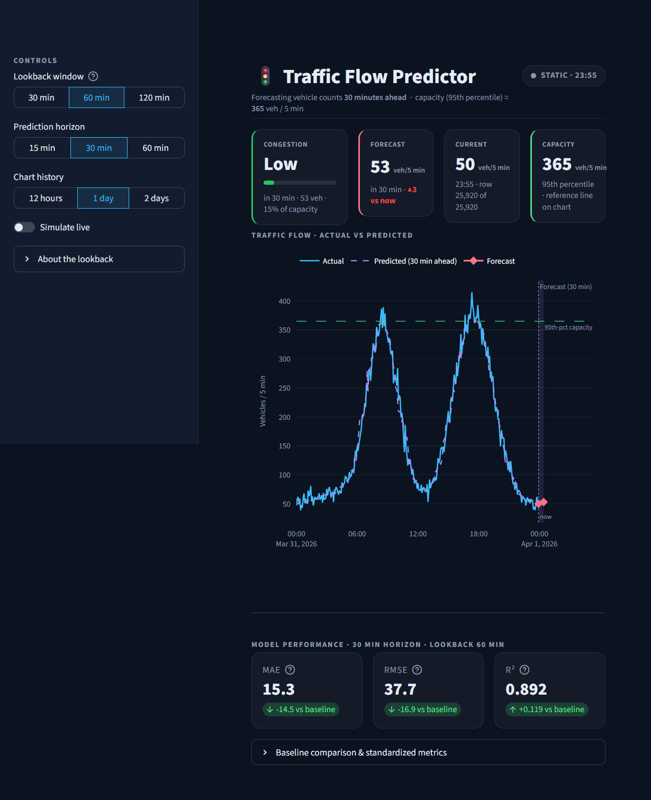

# 🚦 Traffic Flow Predictor

Predict a road's vehicle count **15 / 30 / 60 minutes ahead** from a stream of
5-minute counts, and flag emerging congestion.

The project is deliberately small and honest: synthetic data → windowed XGBoost →
a Streamlit dashboard. Every design decision and its trade-offs are documented
below.

---

## The problem

Vehicle counts arrive every 5 minutes from a single loop detector. Operators want
to know how busy the road will be **15, 30 and 60 minutes from now**, and whether
it is heading toward congestion.

Two things make this non-trivial:

1. **The horizon changes the model.** A 15-minute-ahead forecast and a
   60-minute-ahead forecast carry different signal, so each is trained separately.
2. **Traffic is strongly autocorrelated.** "The next reading equals the last one"
   (a *persistence* baseline) is already hard to beat at short horizons. Any model
   has to justify its complexity against that baseline — so every result below is
   reported against it.

The goal is a reproducible pipeline and an honest comparison, not a
state-of-the-art benchmark.

---

## Architecture

```
┌───────────────────────┐
│ Phase 1 - Data        │   src/mock_stream.py
│ 90 days of 5-min      │   -----> data/raw/traffic.csv
│ synthetic counts      │
└───────────┬───────────┘
            v
┌───────────────────────┐
│ Phase 2 - Features    │   src/data_pipeline.py
│ time features, split, │   cyclic hour/dow, 70/15/15 split
│ scaler, windows       │   StandardScaler fit on train only
│                       │   row = [ lags | mean,std | time ]
└───────────┬───────────┘
            v
┌───────────────────────┐
│ Phases 3-4 - Model    │   src/model.py
│ XGBoost per           │   early stopping on the validation split
│ (lookback x horizon)  │   --> models/xgb_lb{L}_h{H}.joblib
└───────────┬───────────┘       models/scaler.joblib, metrics.json
            v
┌───────────────────────┐
│ Phase 5 - App         │   app.py (Streamlit)
│ dashboard + live loop │   make_features() - same code as training
└───────────────────────┘
```

Two properties keep the pipeline honest:

* **No leakage.** The split is chronological (70% train / 15% validation / 15%
  test) and the `StandardScaler` is fitted on the **training slice only**.
  Windows are built per split, so none straddles a boundary.
* **Training/serving parity.** The dashboard rebuilds features with the *same*
  function used in training (`make_features` vs `make_windows`), verified by a
  dedicated test.

---

## Project structure

```
traffic-flow-predictor/
├── app.py                     # Phase 5: Streamlit dashboard
├── src/
│   ├── config.py              # Shared constants (horizons, lookbacks, thresholds)
│   ├── mock_stream.py         # Phase 1: synthetic data generator + stream generator
│   ├── data_pipeline.py       # Phase 2: time features + windowing / feature building
│   ├── model.py               # Phases 3–4: train, evaluate, persist models
│   └── congestion.py          # Congestion level + colour mapping
├── tests/
│   ├── test_windowing.py          # Windowing / leakage tests
│   ├── test_congestion.py         # Congestion boundary tests
│   └── test_inference_features.py # Training/inference feature parity
├── docs/dashboard.png         # Dashboard screenshot (see below)
├── .streamlit/config.toml     # Dashboard colour theme (dark, sky-blue accent)
├── models/                    # Trained artifacts (generated)
├── data/raw/traffic.csv       # Generated dataset
├── pytest.ini                 # pytest config (puts repo root on sys.path)
└── requirements.txt
```

---

## How to run

Requires Python 3.10+ (tested on 3.13).

```bash
python -m venv .venv
.venv\Scripts\activate          # Windows
# source .venv/bin/activate     # macOS / Linux
pip install -r requirements.txt
```

### 1. Generate the data

```bash
python -m src.mock_stream
```

Creates `data/raw/traffic.csv`: 90 days of 5-minute counts with weekday
double-peaks, a flatter weekend curve, injected accidents/events and ~0.5%
missing sensor values.

### 2. Train the models

```bash
python -m src.model
```

Trains one XGBoost model per **(lookback, horizon)** combination among the fixed
lookbacks `[6, 12, 24]` (30 min / 1 h / 2 h) and horizons `[15, 30, 60]` minutes.
Artifacts:

* `models/xgb_lb{lookback}_h{horizon}.joblib` — one model per pair
* `models/scaler.joblib` — `StandardScaler` fitted on the training split only
* `models/metrics.json` — MAE / RMSE / R² for XGBoost and the persistence baseline

### 3. Run the dashboard

```bash
streamlit run app.py
```

Then open <http://localhost:8501>.

---

## Results (baseline vs. model)

All numbers are on the chronological **test split** (last 15% of the data) —
never on training data — for the default 1-hour lookback. Errors are in vehicle
counts (the standardized error multiplied by the scaler's standard deviation);
R² is scale-independent.

| Horizon | Model            | MAE (veh) | RMSE (veh) | R²        |
| ------- | ---------------- | --------- | ---------- | --------- |
| 15 min  | Persistence      | 19.5      | 37.9       | 0.890     |
| 15 min  | **XGBoost**      | **13.9**  | **35.0**   | **0.906** |
| 30 min  | Persistence      | 29.7      | 54.6       | 0.773     |
| 30 min  | **XGBoost**      | **15.3**  | **37.7**   | **0.892** |
| 60 min  | Persistence      | 49.7      | 77.6       | 0.541     |
| 60 min  | **XGBoost**      | **15.9**  | **40.5**   | **0.875** |

The model's edge grows with the horizon. At 15 minutes persistence is already
strong — the road barely changes — so the gain is modest; by 60 minutes
persistence collapses (R² 0.54) while XGBoost holds R² 0.88.

### Does the lookback matter?

R² by horizon for each shipped lookback:

| Lookback        | 15 min | 30 min | 60 min |
| --------------- | ------ | ------ | ------ |
| 30 min (`lb6`)  | 0.911  | 0.896  | 0.876  |
| 1 h (`lb12`)    | 0.906  | 0.892  | 0.875  |
| 2 h (`lb24`)    | 0.914  | 0.892  | 0.872  |

Longer lookbacks help slightly at 15 minutes and hurt slightly at 60 — there is
no consistent winner, so 1 hour is the default. Adding previous-day and
previous-week lag features was also tested and did **not** improve these numbers,
which is why the feature set stays small.

---

## Screenshot



Static mode at the default settings (1 h lookback, 30 min horizon, 1 day of
history). The shaded region to the right of the dotted "now" line is the
forecast; the KPI cards show congestion state, the next forecast, the current
count and observed capacity.

---

## Dashboard features

* **Sidebar controls**
  * **Lookback window** — history fed to the model: 30 min / 1 h / 2 h
    (see the design note below).
  * **Prediction horizon** — 15 / 30 / 60 minutes.
  * **Chart history** — 12 h / 1 day / 2 days of context.
  * **Simulate live** — streams the mock data forward one 5-minute step per tick.
  * **Live refresh** — seconds between ticks (1–10 s).
* **Main Plotly chart** — actual counts (sky blue), model predictions aligned to
  their target timestamps (dashed violet), and the forecast point (rose
  diamond). The **forecast region is shaded and separated** from history by a
  dotted "now" line and a green capacity reference line.
* **KPI cards** — congestion state (with a capacity-utilisation bar), the
  forecast value, the current count and observed capacity.
* **Congestion indicator** — colour-coded (🟢 Low / 🟡 Medium / 🔴 High)
  computed from the model's forecast relative to the road's observed capacity.
* **Metrics panel** — MAE / RMSE / R² for the selected horizon (XGBoost), each
  with a green/red delta against the persistence baseline, plus a
  persistence-baseline comparison table.

### Colour theme

`.streamlit/config.toml` defines a dark palette (near-black background, sky-blue
accent) and the dashboard's custom CSS + Plotly layout pick it up automatically.
The chart and card colours adapt to the active Streamlit theme via
`st.context.theme.type`, so switching the theme in the header menu keeps charts
and cards consistent.

### Caching

| Concern                | Mechanism            |
| ---------------------- | -------------------- |
| Traffic data           | `st.cache_data`      |
| Metrics JSON           | `st.cache_data`      |
| Series predictions     | `st.cache_data`      |
| Model + scaler loading | `st.cache_resource`  |

### Live mode

Live mode uses Streamlit's built-in `st.fragment(run_every=…)` as the refresh
loop, advancing the mock stream one step per tick. No extra dependency
(`streamlit-autorefresh`) is required. When the cursor reaches the end of the
data it wraps back to one day before the end.

Ticks render without visible flicker:

* The header and KPI cards are written **directly** rather than into
  `st.empty()` placeholders. An empty's subtree is replaced wholesale each
  rerun, which destroyed and rebuilt those blocks every tick and delayed the
  chart's repaint.
* The chart sits in a **fixed-height box** (`st.container(height=…)`), so its
  space stays reserved while Streamlit repaints it — nothing below reflows.
* A short CSS **fade-in** softens the chart's swap.

Streamlit derives a chart's element id from the figure JSON, so the chart is
remounted once per tick by design. Measured on the live loop: ~34–43 ms repaint
per tick and zero layout movement (was up to 223 ms plus layout jumps).

---

## Design notes

### Lookback design (important, honest trade-off)

The lookback window changes the **model input**, so a model trained with one
lookback cannot be used with another. Retraining every time the selection changes
would make the dashboard slow and non-reproducible. The simplest honest design —
used here — is:

> **Train models once for a few fixed lookbacks (6, 12, 24 steps) and let the
> selector pick among the pre-trained models.** The selector does not retrain.

This keeps the app instant while remaining honest about what is happening. If a
different lookback is needed, add it to `LOOKBACK_OPTIONS` in `src/config.py`
and re-run `python -m src.model`.

### Congestion levels

`src/congestion.py` maps a predicted count to a label + colour using the road's
observed **95th-percentile capacity** (`capacity_95th`):

| Ratio of predicted / capacity | Level  | Colour |
| ----------------------------- | ------ | ------ |
| `< 0.40`                      | Low    | green  |
| `0.40 – 0.70`                 | Medium | amber  |
| `≥ 0.70`                      | High   | red    |

Thresholds live in `CONGESTION_THRESHOLDS` in `src/config.py` and are intended to
be tuned. A non-positive capacity falls back safely to **Low**.

---

## Limitations

* **Synthetic data.** Counts are generated from hand-tuned curves, not real
  traffic, so absolute errors are illustrative rather than transferable.
* **One sensor, no space.** There is no spatial correlation between neighbouring
  links, only the history of a single detector.
* **Persistence is a strong baseline at short horizons.** The 15-minute gain is
  real but modest; traffic simply does not change much in a quarter hour.
* **Fixed lookbacks.** Only 30 min / 1 h / 2 h are supported; anything else needs
  retraining.
* **Fixed hyperparameters.** `n_estimators`, `learning_rate` and `max_depth` are
  hard-coded with no search.
* **Arbitrary congestion thresholds.** The 0.40 / 0.70 cut-offs are not
  calibrated against observed incidents.
* **Capacity uses the whole dataset.** The 95th-percentile capacity is computed
  over all data, not the training split.
* **Point forecasts only.** There is no prediction interval or uncertainty
  estimate.
* **No exogenous inputs.** Weather, holidays, roadworks and special events are
  not modelled.

---

## Future work

* **Real data ingestion.** `src/fetch_live.py` is an empty placeholder for a real
  feed (public traffic API or loop-detector stream) to replace the mock stream.
* **Richer features.** Rolling trend/slope, holiday and weather signals, and
  spatial neighbours.
* **Uncertainty.** Quantile regression or conformal intervals instead of a single
  point forecast.
* **Model search.** Hyperparameter tuning and gradient-boosting alternatives
  (e.g. LightGBM), plus sequence models (LSTM / temporal fusion transformer).
* **Threshold calibration.** Fit the congestion cut-offs to real incident data.
* **Multi-step forecasting.** Direct per-horizon models are shipped today; a
  recursive or multi-output model is a natural next step.
* **Ops.** Containerise the app, add CI that runs the test suite, and automate
  retraining when `LOOKBACK_OPTIONS` or the data change.

---

## Tests

```bash
python -m pytest -q
```

Covers windowing/leakage, congestion boundary values, and training/inference
feature parity (so the dashboard builds features exactly like training does).
